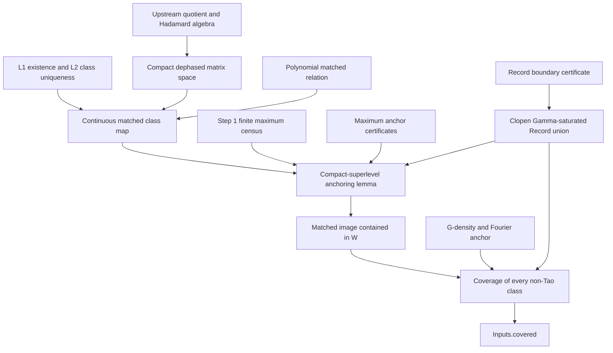

# A smaller route to the actual coverage input

## 1. Conclusion and scope

The upstream finite-corner classification does **not** prove connectedness
of the non-Tao quotient. Its atlas has a physical admissibility constraint
in its parameter domain. Continuity of forced completion does not discharge
that constraint or control the components of that domain.

There is, however, a smaller route to the statement actually consumed by
`NoFourMUBs.Inputs.covered`. It uses a compact-superlevel argument and a
finite list of maximum anchors. It does not need to prove that the whole
non-Tao quotient is connected, to prove sheet parity at arbitrary seeds, or
to join the sheets at F6. In this route even local connectedness of the seed
torus is unnecessary.

The genuinely new reconstruction geometry can be reduced to:

1. **A nonempty single-class matched fibre over every strict seed.** This
   comprises an existence theorem and a uniqueness-up-to-`Equivalent`
   theorem for an explicitly defined polynomial relation.
2. **Density of these matched classes and their conjugates, with the
   Fourier class added, in the non-Tao locus.** Exact surjectivity is a
   stronger sufficient statement, but is not required for coverage.

Neither theorem is supplied by the upstream endpoint. The topology below
proves a conditional reduction, not these remaining global geometry
statements. In particular, this document does not claim to have removed
`thm:regular-seed-domain` or `thm:global-product-regular-escape` from the
existing dossier's proofs. It isolates weaker replacement targets.
The accompanying `STEP2_BLUEPRINT.md`, §7, gives a complete paper proof
of the needed fibre uniqueness L2 using identities on actual physical
sides; its Lean formalization remains a named obligation. Physical
existence L1 and global density are the two mathematical gaps still open
in this return.

Step 1's maximum census, the Record boundary certificate, and finitely many
anchor membership certificates remain separate inputs. Counting an
arbitrary conjunction as a single theorem would make “smallest set”
meaningless; the list above records the distinct geometric content.

## 2. What the upstream atlas actually parametrizes

All declarations in this section are in namespace `Hadamard6`.

In `Hadamard6/FiniteDilation.lean`, the relevant definitions are exactly:

```lean
def IsFiniteDilationCorner (E : Mat3) : Prop :=
  (invertibleHorizontalCandidates E).Nonempty ∧
  (invertibleVerticalCandidates E).Nonempty ∧
  (invertibleHorizontalCandidates E).Finite ∧
  (invertibleVerticalCandidates E).Finite

noncomputable def forcedD (E B C : Mat3) : Mat3 :=
  -C * Matrix.conjTranspose E * Matrix.conjTranspose (B⁻¹)

def Retained (E B C : Mat3) : Prop :=
  IsFiniteDilationCorner E ∧
  B ∈ invertibleHorizontalCandidates E ∧
  C ∈ invertibleVerticalCandidates E ∧
  EntrywiseUnit (forcedD E B C)

noncomputable def completion (E B C : Mat3) : Mat6 :=
  Matrix.fromBlocks E B C (forcedD E B C)

def InFiniteCornerAtlas (H : Mat6) : Prop :=
  ∃ (p : CornerData) (B C : Mat3),
    Retained p.matrix B C ∧ Equivalent H (completion p.matrix B C)
```

Thus the actual domain is

\[
\mathcal D=\{(p,B,C):\operatorname{Retained}(p.\mathrm{matrix},B,C)\}.
\tag{2.1}
\]

The four phases `p : CornerData` are only its base coordinates. The
equations selecting `B,C`, the requirement of finite invertible fibres,
and the final nine modulus equations for `forcedD` remain part of the
domain. The atlas is **not** the image of an everywhere-defined Hadamard
completion on `CornerData`, and it is not the image of the full four-torus
under a continuous map already constructed by upstream.

`Hadamard6/PaperTheorem.lean` proves:

```lean
theorem paper_finite_corner_theorem
    {H : Mat6} (hH : IsHadamard H) : HasFiniteCorner H

theorem paper_finite_corner_completeness
    {H : Mat6} (hH : IsHadamard H) : InFiniteCornerAtlas H

theorem paper_total_output_corollary
    (H : Mat6) : IsHadamard H ↔ InFiniteCornerAtlas H

theorem paper_classification_corollary :
    FiniteCornerAtlasClasses = Set.univ
```

In `Hadamard6/FiniteCornerConsequences.lean`, soundness is:

```lean
theorem retained_completion_isHadamard
    {p : CornerData} {B C : Mat3}
    (h : Retained p.matrix B C) :
    IsHadamard (completion p.matrix B C)
```

This soundness theorem already assumes the final modulus test through
`Retained`. Applying it is not a proof that a proposed pairing passes that
test.

### 2.1 What modest topology supplies

Equip `CornerData` with the topology transported from four copies of the
unit circle and matrices with their finite-dimensional real topology.
On `det B ≠ 0`, matrix inversion is continuous, as follows directly from
the adjugate-over-determinant formula. Matrix multiplication,
conjugate-transpose, and `Matrix.fromBlocks` are continuous. Therefore
`completion` is continuous on \(\mathcal D\). Composing with the quotient
map gives a continuous surjection

\[
\mathcal D\longrightarrow Q=\mathcal H/\mathrm{Equivalent}.
\tag{2.2}
\]

The same is true after deleting the inverse image of Tao's orbit.
These are useful consequences of the existing classification, but no
connectedness of the source is known from that classification.

In fact, block extraction recovers \(p,B,C\) uniquely from a completed
matrix. Completion is consequently a homeomorphism of \(\mathcal D\)
onto the set of dephased Hadamards whose leading corner and actual side
blocks satisfy the retained conditions. Its inverse just extracts the
three displayed blocks and the four entries of the corner. This explains
why calling \(\mathcal D\) a parameter domain does not itself simplify its
global geometry: it still contains the physical Hadamard locus.

### 2.2 Why finite fibres are insufficient

A continuous map from two disjoint circles onto one circle, sending each
copy identically to the target, has a connected parameter base and exactly
two points in every fibre. Its source is disconnected. This elementary
example rules out the proposed inference “connected base + finite fibres
implies connected total parameter space.” It is a logical counterexample
to that inference, not a counterexample to the Hadamard conjecture.

Nor does finiteness imply continuity of an arbitrarily chosen root or of
its quotient class. One must prove a branch identification, a suitable
closed-graph uniqueness theorem, or equivalent information. Finally,
maximizing \(R\) on an unknown physical subdomain can produce constrained
maxima on its boundary inside \(\{R>0\}\). Step 1 classifies maxima on the
ambient torus, so it does not remove such boundary points.

Finite-corner existence is also different from strict-corner existence:
upstream's universal theorem supplies a finite corner for F6, whereas
`reference/MinimalConstruction/Proofs/FOURIER_CRITICAL_LOCUS.md` and its
exact Fourier census give \(R=0\) at every F6 corner. Thus even on actual
Hadamards, finiteness cannot simply be translated into \(R>0\).

**Answer to A2.1.** A proof of connectedness of an appropriate part of
\(\mathcal D\), or a proof of a connected component-intersection graph
for its quotient images, would suffice. It is a new global theorem and is
not an established alternative proof. Upstream finite corners and forced
completion do not, on their own, avoid the missing physical-domain and
global-reach content.

## 3. A precise replacement for the radical constructor

Let

\[
\mathcal H_0=\{H:\operatorname{IsHadamard}H,
  \ H_{0j}=H_{i0}=1\}
\]

be the dephased Hadamards, and let \(q:\mathcal H_0\to Q\) take an
equivalence class. This is a compact space: entrywise unit modulus bounds
all entries, and the dephasing and Hadamard equations are closed.

For a phase block \(Y\), define the polynomial signature

\[
T(Y)=-\operatorname{perm}(Y)\det(Y)^2
       \prod_{i,j}\overline{Y_{ij}}.
\tag{3.1}
\]

This is a polynomial in real and imaginary matrix entries. It has no
determinant denominator. On invertible unit-entry blocks it is
\(|\det Y|^2\Theta(Y)\), with the \(\Theta\) of the reference sheet note.

Let \(P=\mathbb T^4\), let \(S=\{s:R(s)>0\}\), and write a matrix in
blocks as \(H=\begin{psmallmatrix}E&B\\C&D\end{psmallmatrix}\). Define
the following relation, whose matrix variable is already in
\(\mathcal H_0\):

\[
\begin{split}
\mathcal M_+(s,H)\quad\Longleftrightarrow\quad&
 E=E(s),\\
 &2T(B)=\chi(s)+i\sqrt{R(s)},\\
 &2T(C)=\chi(s)-i\sqrt{R(s)}.
\end{split}
\tag{3.2}
\]

The signatures match the reference positive sheet because the strict
Gram identities give \(|\det B|^2=|\det C|^2=g\) and
\(z_+=(\chi+i\sqrt R)/(2g)\). That identification is algebra, rather
than an additional choice of a principal complex square or cube root.
The sole square root in (3.2) is the continuous positive real square root.
Equivalently, its semialgebraic version adjoins a real \(t>0\) satisfying
\(t^2=R(s)\) and replaces \(\sqrt{R(s)}\) by \(t\). Thus “polynomial
matched relation” refers to these polynomial signature equations, with
this explicitly specified positive real lift; it does not assert that
the displayed function \(\sqrt R\) is a polynomial.

The local replacement theorem is the conjunction of the following two
statements.

**L1: existence.** For every \(s\in S\), there exists
\(H\in\mathcal H_0\) satisfying \(\mathcal M_+(s,H)\).

**L2: one quotient class per fibre.** If
\(\mathcal M_+(s,H)\) and \(\mathcal M_+(s,K)\), then
`Equivalent H K`.

L1 is a physical theorem: it asserts a full Hadamard, including the last
block's flatness, at every strict seed. It cannot be inferred from the
existence of finite side candidates. L2 concerns only the displayed
matched fibre. It does not classify every side orbit or every nonmatched
completion.

### 3.1 Continuity follows from L1–L2

All equations in (3.2) are continuous, so their solution relation is
closed in \(S\times\mathcal H_0\). L1–L2 define a unique quotient-valued
map \(f:S\to Q\), with \(f(s)=q(H)\) for any matched representative.

For any closed \(F\subseteq Q\),

\[
f^{-1}(F)=\operatorname{pr}_S
 \bigl(\mathcal M_+\cap(S\times q^{-1}(F))\bigr).
\tag{3.3}
\]

The set being projected is closed, and its second factor
\(\mathcal H_0\) is compact. Projection along a compact factor is a
closed map. Thus every closed-set preimage in (3.3) is closed, proving
continuity of \(f\).

This proof handles root collisions and arbitrary auxiliary branch cuts
without making a globally continuous matrix choice. It also needs no
classification of the ambient Hadamard variety as a manifold.

### 3.2 The weakest global reach used here

Let \(F\in Q\) denote the Fourier class and let \(c:Q\to Q\) be
entrywise conjugation. Let \(X\subseteq Q\) be the complement of Tao's
orbit predicate. The following density assertion suffices:

\[
\boxed{X\subseteq
 \overline{\{F\}\cup f(S)\cup c(f(S))}^{\,Q}.}
\tag{G-density}
\]

It can be stated without \(f\) by using the set of classes of matrices
in (3.2). It is therefore an explicit geometric claim about a polynomial
matched locus, and does not mention a Record family or its coverage.

A stronger sufficient statement is:

\[
\begin{gathered}
\operatorname{IsHadamard}H,\quad
\neg\operatorname{IsTaoOrbit}H,\quad H\not\sim F_6\\
\Longrightarrow
\exists s\in S,\ \exists K\in\mathcal H_0:\ 
\mathcal M_+(s,K)\ \land
   (\operatorname{Equivalent}H K\ \lor
    \operatorname{Equivalent}H\overline K).
\end{gathered}
\tag{G-exact}
\]

Taken as hypotheses, the reference MC1–MC5 statements imply G-exact. For coverage, only
G-density is needed. In particular, boundary classes need not themselves
have a strict corner if they are limits of the indicated matched classes.
Upstream's finite-corner theorem supplies neither G-density nor G-exact.

## 4. The compact-superlevel anchoring lemma

This lemma is the central simplification of the direct coverage route.

**Lemma.** Let \(P\) be a compact topological space, let
\(r:P\to\mathbb R\) be continuous, and let \(S=\{r>0\}\). Suppose
\(U\subseteq S\) is both open and closed in \(S\), and every positive
local maximum of \(r\) on \(P\) belongs to \(U\). Then \(U=S\).

**Proof.**

1. Suppose \(B=S\setminus U\) is nonempty. It is both open and closed
   in \(S\). Since \(S\) is open in \(P\), \(B\) is open in \(P\).
2. The closure \(\overline B\) is compact. Continuity gives
   \(\overline B\subseteq\{r\ge0\}\).
3. Relative closedness of \(B\) in \(S\) gives
   \(\overline B\cap S=B\). Therefore
   \(r=0\) on \(\overline B\setminus B\).
4. The continuous function \(r\) attains a maximum at some
   \(b\in\overline B\). A point of \(B\) has positive value, so
   \(r(b)>0\); step 3 implies \(b\in B\).
5. Because \(B\) is open in \(P\), the maximum of \(r\) on
   \(\overline B\) is a local maximum on \(P\) at \(b\). The assumed
   anchor property gives \(b\in U\), contradicting \(b\in B\).

No local connectedness, connected component theorem, gradient flow,
path-lifting theorem, or differentiability is used. ∎

In the application, \(P=\mathbb T^4\), \(r=R\), and
\(U=f^{-1}(W)\). Continuity of \(f\) and clopenness of \(W\) make
\(U\) clopen. Step 1 reduces its anchor condition to a finite check.

## 5. Directly obtaining `Inputs.covered`

For the certified Record predicate `Ball`, define a subset of the full
Hadamard quotient by

\[
W=\{[H]:\exists G,K,
 \operatorname{InGamma}(H,G)\land\operatorname{Ball}(K)
 \land\operatorname{Equivalent}(G,K)\}.
\tag{5.1}
\]

Hadamard invariance ensures that any such \(K\) is Hadamard. Equivalent
representatives give the same predicate, so (5.1) is well-defined.
Conjugation and transposition commute and are involutions. Consequently
\(W\) is invariant under both, including conjugation.

### 5.1 The Record condition makes W clopen in the full quotient

Let \(R_i\) be the compact quotient images of the Record regions and
\(U_i\) their certified quotient interiors. Take the union over the
finite family and all four operations of \(\Gamma\).

* This union of \(R_i\)-images is closed: the quotient is Hausdorff,
  each region image is compact, and the union is finite.
* If every actual Hadamard on every source Record boundary transfers to
  a target interior after an allowed operation, that same union equals
  the union of the \(U_i\)-images. It is therefore open.

This applies to the **full** quotient \(Q\), because the boundary
condition in `reference/MINIMAL_PROOF.md` quantifies over every Hadamard
on every Record boundary, not only the non-Tao ones. For this version of
the argument, Tao isolation and a proof that \(f(S)\) avoids Tao are not
needed. If a checker instead certifies boundary transfer only outside
Tao's orbit, it gives clopenness only in \(X\); that weaker certificate
requires separately proving that \(f\) takes values in \(X\).

The topology needed to show that quotient interiors are open is the
elementary local phase-gauge argument in
`reference/coverage/returns/A_deltoid/SHEETS_TOPOLOGY.md`, §5.1. It does
not require a four-dimensional solution manifold or unique phase lifts.

### 5.2 Finite anchors

Let \(M\subseteq S\) be the finite list containing every positive local
maximum of \(R\) on the torus. Using the Step 1 census, one may take the
18 distinct maximum seeds; taking all 144 listed symmetry images is a
harmless redundant alternative. Require certificates for

\[
F\in W,\qquad f(m)\in W\quad\text{for every }m\in M.
\tag{5.2}
\]

For each maximum seed it suffices to provide one exact matched matrix
and prove that its class meets a Record after an allowed operation. L2
then identifies that class with \(f(m)\). At most 18 matched anchors and
one Fourier anchor are needed. It is unnecessary to prove that all 18
matched matrices are equivalent to one another.

There is now a proved paper-level reduction to **one positive matched
maximum anchor plus the Fourier anchor**. The exact maximum census's 18
points already form the orbit under pure row/column permutations and
re-dephasing of the corner. The polynomial signatures are invariant under
these monomial operations, and the corresponding scalar Gram invariants
are unchanged. Therefore the positive matched relation is preserved;
L2 identifies the transported matrices' quotient classes. The restricted
transport proof is in `STEP2_BLUEPRINT.md`, §5.3.

This restricted maximum-orbit transport has not yet been formalized, and
the generic Lean coverage interface continues to take a finite anchor
family. It is not a formalization of Claim B at arbitrary seeds. The
generic theorem is usable without the one-anchor reduction by supplying
(5.2) at all 18 seeds. Conversely, a certificate containing only the
Fourier class does not yet supply either version of the maximum-anchor
condition. The handoff does not include Record data sufficient to certify
these maximum-anchor memberships.

### 5.3 Assembly

Assume L1, L2, G-density, Step 1, the complete Record boundary condition,
and the finite anchor certificates (5.2).

1. Section 3 gives a continuous map \(f:S\to Q\).
2. Section 5.1 gives a clopen set \(W\subseteq Q\).
3. The compact-superlevel lemma, applied to \(f^{-1}(W)\), yields
   \(f(S)\subseteq W\).
4. Conjugation invariance gives \(c(f(S))\subseteq W\), and the Fourier
   anchor gives \(F\in W\).
5. Closedness of \(W\) gives
   \(\overline{\{F\}\cup f(S)\cup c(f(S))}\subseteq W\).
6. G-density gives \(X\subseteq W\). Unfolding (5.1) is exactly

   ```lean
   ∀ H, IsHadamard H → ¬ IsTaoOrbit H →
     ∃ G K, InGamma H G ∧ Ball K ∧ Equivalent G K
   ```

This is the `covered` field in `NoFourMUBs/Skeleton.lean`. No conclusion
about `QuartetEdge` follows until the separately required Record exclusion
and Tao exclusion inputs are also supplied.

## 6. Which parts of MC1–MC5 remain necessary?

| Reference obligation | What the direct route uses instead |
|---|---|
| MC1: every non-F6 class has a strict corner | G-density; G-exact is a sufficient stronger version. No pointwise strict-corner theorem for boundary classes is needed if density is proved directly. |
| MC2: exactly two side orbits and exhaustive pairings | L2 only on the marked positive fibre. Full side-fibre exhaustion is unnecessary to the topological assembly. |
| MC3: every radical divisor and branch choice behaves correctly | Polynomial graph closedness plus L1–L2 imply quotient continuity. The raw radical constructor and its sign/cube-root rules can be omitted from this route. |
| MC4: both matched completions flat and every nonmatched exception Tao | L1 requires existence of the displayed matched physical fibre. The exhaustive nonmatched converse is used by the dossier's proposed route to G-exact, but need not be a separate theorem if G-density is proved directly. |
| MC5: opposite-corner/fixed-seed positive-sheet transport | G-density or G-exact already permits the conjugate matched image. No opposite-corner transport theorem is needed in the assembly. |
| Claim B: full sheet parity | Omitted; finitely many maximum anchors replace it. |
| Claim C: quotient continuity | Derived by the compact-fibre argument, without radical branch regularity. |
| F6 joining family | Omitted; F6 is an explicit anchor. |
| Tao isolation | Omitted when the full boundary condition makes W clopen in Q. |

The remaining geometry has not disappeared. In the supplied paper dossier,
`MATCHED_FLATNESS.md` imports `thm:regular-seed-domain` to obtain L1.
`NONMATCHED_EXCEPTIONS.md` imports both that theorem and
`thm:global-product-regular-escape`, as well as the necessary direction of
the paragraph before `eq:affine-minus-matching-main`, on its route to
G-exact. The finite-corner equality in Lean is not a replacement for those
uses. A proof avoiding these imports must establish L1 and the chosen
reach assertion by another argument.

## 7. Topological infrastructure and formalization targets

The quotient should first receive the quotient topology induced by
`Had6 := {H : Mat6 // IsHadamard H}`. Upstream defines
`HadamardClass6 := Quotient had6EquivalenceSetoid`, but the classification
endpoint is a statement about sets of classes, not a theorem about this
topology.

For compactness and Hausdorffness, use the compact group of unit row and
column phases together with the two finite permutation groups. Its action
is continuous, and the equivalence relation is the compact image of that
group times the compact Hadamard space, hence is closed. The quotient is
compact Hausdorff. Alternatively, dephase first; on dephased Hadamards,
equivalence is a finite union of graphs of continuous re-dephasing maps
after row and column permutations. This also gives a closed relation.

The necessary Mathlib interfaces are ordinary ones: `Continuous`,
`IsCompact`, `IsClosed`, `IsOpen`, `IsClopen`, `closure`, quotient topology,
continuous image compactness, and the extreme value theorem for a
continuous real-valued function on a nonempty compact set. For the original
connectedness route the corresponding interfaces are `IsPreconnected`,
`IsConnected`, continuous-image and closure lemmas, and the connected-space
clopen dichotomy. The direct route avoids that connectedness API entirely.

The following declaration names were checked in the bundled Mathlib
source at the pinned version:

| Required fact | Mathlib declaration |
|---|---|
| Compact set of matrices with entries in a compact set | `IsCompact.matrix` |
| A compact subset supplies a compact subtype | `isCompact_iff_compactSpace` |
| The canonical quotient projection is continuous | `continuous_quotient_mk'` |
| The canonical projection is a quotient map | `isQuotientMap_quotient_mk'` |
| A quotient of a compact space is compact | `Quotient.compactSpace` |
| Projection along a compact second factor is closed | `isClosedMap_fst_of_compactSpace` |
| Continuous inverse images preserve clopen sets | `IsClopen.preimage` |
| A continuous real function attains its maximum on a nonempty compact set | `IsCompact.exists_isMaxOn` |
| A maximum on a neighborhood is a local maximum | `IsMaxOn.isLocalMax` |
| Matrix Gram operations are continuous | `Continuous.matrix_mul`, `Continuous.matrix_conjTranspose` |

`output/lean/QuotientTopology.lean` implements compactness of the upstream
`Had6` subtype and the natural quotient projection. The compilation status
of that implementation is reported separately in `STATUS.md`.

There is no need to formalize the particular quotient phase metric to
prove the direct coverage theorem. The metric remains useful when checking
Record inclusions. If the manuscript insists that connectedness is meant
in that metric, its induced topology must be shown to equal the quotient
topology; it must not be supplied as an unrelated arbitrary metric.
Locally, this equality follows from continuous entrywise logarithms and
the horizontal projection estimate in `SHEETS_TOPOLOGY.md`, equation (13).

### 7.1 Optional return to connectedness of X

The same compact-superlevel lemma gives a further paper-level consequence.
Assume L1–L2 and the restricted maximum transport of §5.2, so every
positive local maximum maps to one class \(K\). Let \(A=f(S)\), which
is nonempty by the positive maximum exhibited in Step 1. Regard \(f\)
as a continuous map into its image \(A\). For every relatively clopen
\(U\subseteq A\) containing \(K\), its inverse image contains every
positive local maximum. The lemma gives \(f^{-1}(U)=S\), hence \(U=A\).
The clopen characterization of connectedness therefore makes \(A\)
connected, without a local-connectedness or component argument.

Obtaining connectedness of \(X\) additionally requires all of the
following facts: \(A\subseteq X\); \(X\) is closed in \(Q\), as follows
from openness of the isolated Tao locus; conjugation preserves \(X\),
is a homeomorphism, and fixes the Fourier class \(F\in X\); and there
is a continuous non-Tao, non-Fourier family approaching \(F\), such as
the explicitly verified Fourier family in `CONNECTEDNESS.md`. The
literal-corner/finitely-many-corner argument is one way to establish
\(A\subseteq X\) from Tao isolation, but that step must be included.

Under these extra conditions and G-density,
\(X=\{F\}\cup\overline A\cup\overline{c(A)}\). The nonexceptional
Fourier family puts \(F\) in the closed union
\(\overline A\cup\overline{c(A)}\); conjugation then puts it in both
sets. They are connected closures with a common point, so their union
is \(X\) and is connected. These additional steps are **not formalized
in this return**. The recommended direct coverage theorem retains its
smaller topological interface and does not use them.

## 8. Dependency diagram



The unresolved mathematical arrows are L1 and G-density (or its stronger
replacement G-exact), together with the external certificate inputs.
L2 has the paper proof in `STEP2_BLUEPRINT.md`, §7, and is still an explicit
input to the Lean assembly until that proof is formalized. The diagram
does not use “connectedness of the retained domain” as a black-box premise.
